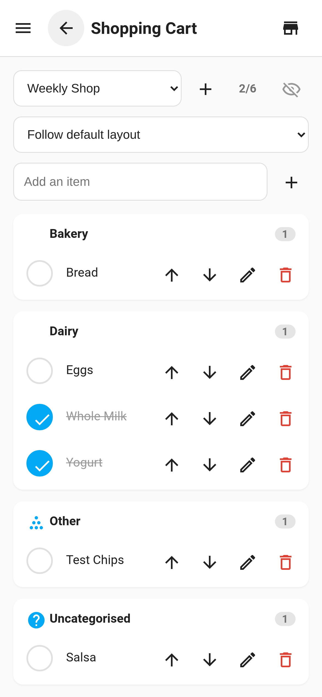
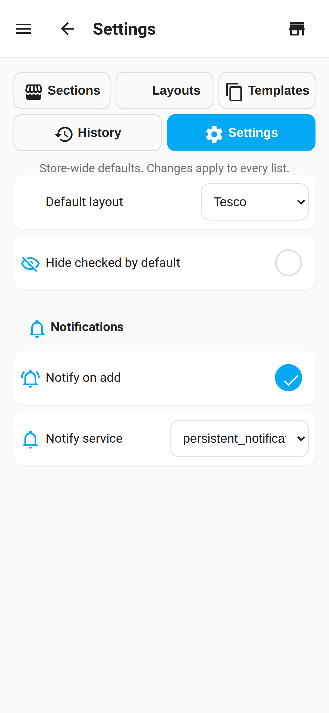

# Better HA Shopping Cart

An improved Home Assistant supermarket shopping cart: a mobile-friendly shopping
list custom integration with store sections, named layouts per supermarket,
tick boxes, list templates, and native Home Assistant to-do entities (so it
works with dashboards, the built-in to-do card, and Assist voice).

**v1.0** — all v1 features shipped.

| Shopping view | Store management → Settings |
| --- | --- |
|  |  |

## Features (v1)

- **Sections** — create supermarket sections/groups, reorder them (drag or
  buttons) to match a real store.
- **Named layouts** — save a layout per supermarket (e.g. "Tesco", "Costco")
  with its own section order and hidden sections; set a store-wide default or
  pin one per list.
- **Tick boxes** — check items off while walking the store, with a
  hide-checked-items toggle and a live done/total counter.
- **Multiple named lists** at once (Weekly, Party, BBQ), switchable from the
  shopping view.
- **List templates** — save a list (or build one from scratch), edit it, and
  apply it to the active list in one tap.
- **Quick re-add from history** — recently bought items with one-tap re-add,
  plus "repeat last shop".
- **Quantity & units** per item (e.g. `2 kg potatoes`) and **notes**
  (e.g. "the green ones").
- **Native HA to-do entity** per list — works with the built-in to-do card,
  dashboards, and Assist voice ("add milk to shopping list").
- **Smart auto-categorisation** of new items into sections: an explicit
  section, then your learned corrections, then a built-in keyword dictionary,
  then "Uncategorised".
- **Notifications** — optionally notify a configured notify service with
  `"<user> added <item> to <list>"` whenever an item is added.
- **Store management** — a five-tab screen: Sections, Layouts, Templates,
  History, and Settings.

## Requirements

- Home Assistant **2025.1.0** or newer (tested on 2025.1.4).

## Installation

### HACS

1. In Home Assistant, open **HACS → Integrations**.
2. Search for **Smartcart** and click **Download**.
3. Restart Home Assistant.
4. Add the integration: **Settings → Devices & Services → Add Integration**
   → **Smartcart**.

### Manual

1. Clone or download this repository.
2. Copy the `custom_components/better_shopping_cart` folder into your
   Home Assistant configuration directory (next to `configuration.yaml`).
3. Restart Home Assistant.
4. Add the integration: **Settings → Devices & Services → Add Integration**
   → **Smartcart**.

## Configuration

Go to **Settings → Devices & Services → Add Integration** and select
**Smartcart**. No credentials are required — optionally give the
entry a name. The integration is single-entry: one store per instance.

The panel appears in the sidebar as **Shopping Cart** (route
`/shopping-cart`). It seeds itself on first run with nine default sections,
a "Weekly" layout, and a "Weekly Shop" list; everything is editable from the
**Manage store** button.

### Settings screen

**Manage store → Settings** holds store-wide defaults that apply to every
list:

- **Default layout** — which layout new/unaligned lists follow (or "Store
  default" for none).
- **Hide checked by default** — start the shopping view with checked items
  hidden.
- **Notify when an item is added** — when enabled, adding an item calls the
  chosen notify service with `"<user> added <item> to <list>"`.
- **Notification service** — any `notify.` service configured in Home
  Assistant (e.g. `notify.notify` for mobile push,
  `notify.persistent_notification` for an in-UI banner).

### Services

The integration exposes two services (lists and sections are matched by name,
case-insensitive), useful in automations, scripts and voice commands:

- `better_shopping_cart.add_item` — `name`, `list`, optional `section`,
  `quantity`, `unit`, `note`.
- `better_shopping_cart.complete_list` — marks every item in `list` as done
  and stamps the completion time.

## Limitations

- Single config entry — one store per Home Assistant instance.
- Notifications are a single message per added item; there is no per-list
  filter or custom message template yet.
- Layouts control section order and visibility, not per-list item sets.
- English only; auto-categorisation relies on the built-in English keyword
  map plus your learned corrections.
- No offline/PWA support.

## Troubleshooting

- **Integration missing from "Add Integration"** — restart Home Assistant
  after installing; custom integrations are registered at startup.
- **Panel missing or blank** — hard-refresh the browser. HA serves the panel
  JS through a cached static resource, so a stale tab can hold onto old code.
- **HACS won't install** — your Home Assistant must be 2025.1.0 or newer.
- **Notification not arriving** — check the Settings screen: the toggle must
  be on and the picker must hold a *configured* notify service. `notify` is
  built in (mobile push), `persistent_notification` shows an in-UI banner,
  and `demo` logs to the developer tools; custom notify services must exist
  in your HA configuration first.
- **Item landed in the wrong section** — edit the item and pick a section;
  your correction is remembered, so the same item is placed correctly next
  time.
- **To-do entity not appearing** — each list has a `todo.*` entity; check
  **Settings → Devices & Services → Entities**.

## License

MIT — see [LICENSE](LICENSE).
